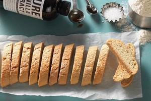

# American-Style Vanilla Biscotti

**Yield:** Yield: 30 to 40 biscotti, depending on size.  
**Source:** <http://www.kingarthurflour.com/recipes/american-style-vanilla-biscotti-recipe>

## Ingredients

- 6 tablespoons butter, salted or unsalted
- 2/3 cup sugar
- 1/2 teaspoon salt
- 2 to 3 teaspoons vanilla extract
- 1/4 teaspoon almond extract, optional
- 1 1/2 teaspoons baking powder
- 2 large eggs
- 2 cups King Arthur Unbleached All-Purpose Flour
- coarse white sparkling sugar, for sprinkling on top, optional

## Method

1. Preheat the oven to 350°F. Lightly grease (or line with parchment) one large (about 18" x 13") baking sheet.
2. In a medium-sized bowl, beat the butter, sugar, salt, vanilla, almond extract (if you're using it), and baking powder until the mixture is smooth and creamy.
3. Beat in the eggs; the batter may look slightly curdled. At low speed of your mixer, add the flour, stirring until smooth; the dough will be sticky.
4. Plop the dough onto the prepared baking sheet. Divide it in half, and shape it into two 9 1/2" x 2" logs, about 3/4" tall. Straighten the logs, and smooth their tops and sides; a wet spatula or wet bowl scraper works well here. Sprinkle with coarse white sparkling sugar, if desired, pressing it in gently.
5. Bake the dough for 25 minutes. Remove it from the oven.
6. Using a spray bottle filled with room-temperature water, lightly but thoroughly spritz the logs, making sure to cover the sides as well as the top. Softening the crust just this little bit will make slicing the biscotti much easier. Reduce the oven temperature to 325°F.
7. Wait 5 minutes, then use a sharp chef's knife or serrated knife to cut the log crosswise into 1/2" to 3/4" slices. Or cut the biscotti on the diagonal, for fewer, longer biscotti. As you're slicing, be sure to cut straight up and down, perpendicular to the pan; if you cut unevenly, biscotti may be thicker at the top than the bottom, and they'll topple over during their second bake.
8. Set the biscotti on edge on the prepared baking sheet. Return the biscotti to the oven, and bake them for 25 to 30 minutes, until they feel very dry and are beginning to turn golden. They'll still feel a tiny bit moist in the very center, if you break off a piece; but they'll continue to dry out as they cool.
9. Remove the biscotti from the oven, and transfer them to a rack to cool. Store airtight at room temperature; they'll stay good for weeks.

## Notes

- Variations: Add up to 2 cups nuts, dried fruit (dried, not fresh), or chips to the dough, along with the flour. Adjust the spice to suit the add-in, if desired; e.g., add 1 teaspoon cinnamon with 1 cup chopped dried apple and 1 cup diced pecans. Or substitute hazelnut, butter-rum, or your favorite flavor for the vanilla. A classic Italian anise biscotti is made with 1/2 teaspoon anise extract (or 1/8 to 1/4 teaspoon anise oil, to taste), and 1 tablespoon fennel seeds.
