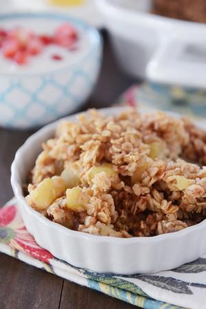

# Apple and Cinnamon Baked Oatmeal

**Yield:** 8  
**Source:** <https://www.melskitchencafe.com/amish-style-apple-and-cinnamon-baked-oatmeal/>

## Ingredients

- 3 cups old-fashioned rolled oats
- 1 1/2 teaspoons baking powder
- 2 teaspoons ground cinnamon
- 1/4 teaspoon ground nutmeg
- 3/4 teaspoon salt
- 1/2 cup lightly packed brown sugar (more to taste if you like things a bit sweeter)
- 2 1/2 cups milk
- 2 large eggs
- 1 teaspoon vanilla extract
- 4 tablespoons butter or coconut oil, melted
- 2-3 large tart, sweet apples (like Honey Crisp or Gala), peeled, cored and diced

## Method

1. Lightly grease a 8 X12-inch or 9 X13-inch baking pan or 9 X9-inch (for super thick oatmeal) with nonstick cooking spray and set aside. Preheat the oven to 325 degrees F (don't preheat the oven if making ahead of time and refrigerating overnight).
2. In a large bowl, whisk together the oats, baking powder, cinnamon, nutmeg, salt and brown sugar.
3. In a large liquid measuring cup or medium bowl, whisk together the milk, eggs, and vanilla.
4. Pour this mixture over the dry ingredients and add the melted butter or coconut oil. Stir or whisk to combine.
5. Arrange the diced apples evenly over the bottom of the baking dish and pour the oatmeal mixture over the top. You can cover and refrigerate overnight at this point or bake right away (uncover before baking the next morning).
6. Bake for 35-45 minutes until the top is golden and the mixture is setup and not super jiggly.
7. Serve warm or at room temperature with a little milk poured over the top, if you want.

## Notes

- Add Ins: I'm not a nuts or raisins in my oatmeal kind of girl, but if you are, you can add one or both to the dry ingredients before mixing in the milk/egg mixture.
- Make Ahead: if you are making it ahead of time and refrigerating overnight, some of the apples may pop up to the top and brown slightly - it doesn't affect the taste.
- Apples: for just a standard Amish-style baked oatmeal, you could omit the apples. If baking in a smaller pan (like a 9 X9-inch pan), you might only want to use two apples instead of three.
- Pan Size: can really be varied with this recipe - smaller pans will result in a thicker oatmeal; just keep an eye on baking time.
