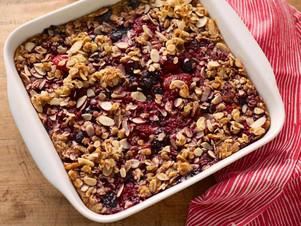

# Berry-Oatmeal Bake

**Yield:** Serves 6  
**Source:** <https://www.foodnetwork.com/recipes/food-network-kitchen/berry-oatmeal-bake-3362604>

## Ingredients

**Oatmeal**

- 2 teaspoons unsalted butter
- 1 1/4 cups old-fashioned rolled oats
- 3 tablespoons light brown sugar
- Kosher salt
- 1 2/3 cups plain unsweetened almond milk
- 1 large egg
- 1 teaspoon pure vanilla extract
- 1/4 teaspoon pure almond extract

**Topping**

- 1/3 cup skin-on sliced almonds
- 1/3 cup old-fashioned rolled oats
- 1/3 cup light brown sugar
- 2 tablespoons unsalted butter, melted
- 1 tablespoon whole-wheat pastry flour or unbleached all-purpose flour
- 1/8 teaspoon ground cinnamon
- Kosher salt
- 12 ounces frozen mixed berries, thawed (2 1/2 cups frozen; 1 1/2 cups thawed)
- Two-percent Greek yogurt or low-fat milk, for serving, optional

## Method

1. Preheat the oven to 350 degrees F. Grease a 2-quart baking dish or 8-inch square baking pan with the butter.
2. For the oatmeal: Stir together the oats, sugar and 1/8 teaspoon salt in a large bowl. Whisk together the almond milk, egg, vanilla and almond extract in a medium bowl. Pour the milk mixture into the oat mixture and stir well to combine.
3. For the topping: Stir together the almonds, oats, sugar, butter, flour, cinnamon and 1/8 teaspoon salt in a medium bowl until evenly combined.
4. To assemble: Pour the oatmeal into the prepared baking dish. Arrange the berries (including any juices) over the oatmeal. Sprinkle with the topping. Bake until lightly browned and just set, about 50 minutes. Let cool on a rack for 10 to 15 minutes. Serve warm with a dollop of yogurt or a splash of milk if using.
