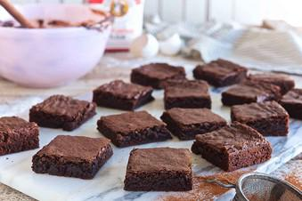

# Brownie Pots

**Source:** <https://www.kingarthurflour.com/recipes/quick-and-easy-fudge-brownies-recipe>

## Ingredients

- 40 g flour
- 21 g cocoa
- 116 g sugar
- 1/6 teaspoon salt
- 1/12 teaspoon baking powder
- 1 large egg
- 38 g unsalted butter, melted (~2.75 Tbsp)
- 17 g vegetable oil
- 2/3 teaspoons vanilla extract
- 1/2 cup white chocolate, roughly chopped
- 1/4 cup Reese's chcolate peanut butter spread

## Method

1. Mix batter. Add half to two greased ramekins, add the Reese's spread, then add the rest. Bake at 350 F for 40 m.
