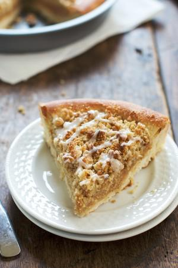

# Deep Dish Cinnamon Streusel Dessert Pizza

**Yield:** Serves: 8  
**Source:** <http://pinchofyum.com/deep-dish-cinnamon-streusel-dessert-pizza>

## Ingredients

**Pizza:**

- half of this batch of dough or any other pizza dough**
- cinnamon sugar to taste
- ¾ cup + 2 tablespoons flour
- ⅓ cup brown sugar
- ¼ cup white sugar
- 2 tablespoons cold butter, cut into small pieces
- 2 tablespoons olive oil**
- ¼ teaspoon salt

**Glaze:**

- ½ cup powdered sugar
- 1 tablespoon real maple syrup
- 1 tablespoon heavy cream

## Method

1. Crust: Preheat the oven to 425. Generously oil a round cake pan. Place the ball of dough in the cake pan and press outwards until the edges of the dough are creeping up the sides of the pan. Sprinkle the dough lightly with cinnamon sugar.
2. Crumbs: Pulse the flours and sugars in a food processor with the butter and oil (or form crumbs with your hands). Pulse JUST until crumbs form and sprinkle over the pizza on top of the unbaked crust.
3. Bake for anywhere from 8-10 minutes. When the crust and topping are golden brown, remove from oven and allow to cool slightly.
4. Whisk the powdered sugar, maple syrup, and cream together. Adjust consistency with a little extra water or milk. Drizzle over the warm pizza. Cut into wedges and serve with coffee or a big glass of milk. Mmm.

## Notes

- *I was already making the cinnamon swirl bread when I made this recipe, so I just used half of the base dough for my crust in this recipe. I've also used store bought dough rolled into a circle and that worked just fine, too. You can adjust the amount of dough depending on how thick you want it.
- *Use canola oil if you're worried about the taste of the olive oil. I didn't notice a taste at all.
