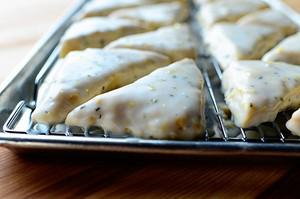

# Lemon Rosemary Scones

**Yield:** 24 Servings  
**Source:** <http://thepioneerwoman.com/cooking/lemon-rosemary-scones/>

## Ingredients

**Scones:**

- 3 cups All-purpose Flour
- 2/3 cups Sugar
- 5 teaspoons Baking Powder
- 1/4 teaspoon Salt
- 2 sticks (1/2 Pound) Unsalted Butter, Chilled And Cut Into Pieces
- 1 whole Large Egg
- 1 cup Heavy Cream
- 1 Tablespoon Finely Minced Fresh Rosemary
- Zest Of 1 Lemon

**Glaze:**

- 5 cups Powdered Sugar, Sifted
- 1/2 cup Whole Milk, More If Needed For Thinning
- Zest And Juice From 1 Lemon
- 1 teaspoon Finely Minced Fresh Rosemary
- Dash Of Salt

## Method

1. Preheat oven to 350 degrees.
2. Sift together flour, sugar, baking powder, and salt.
3. Mix cream with egg, lemon zest and rosemary and allow to sit for 10 to 15 minutes to steep.
4. Use a pastry cutter or two knives to cut the butter pieces into the flour. Keep going until mixture resembles crumbs. Mix wet mixture with flour mixture; stir gently with a fork until combined. Mix should be crumbly, but if it's too crumbly to work with, splash in a small amount of heavy cream.
5. Turn dough onto a floured surface and lightly press it together until it forms a rough rectangle. Use a rolling pin to roll into a rectangle about 1/2 inch to 3/4 inch thick. Use your hands to help with the forming if necessary. Final rectangle should be about 18 inches by about 10 inches.
6. Use a knife to trim into a symmetrical rectangle, then cut the rectangle into 12 symmetrical squares/rectangles. Next, cut each square/rectangle in half diagonally, to form smaller triangles.
7. Transfer to a parchment or baking mat-lined cookie sheet and bake for 18 minutes, removing from the oven just before they start to turn golden. Allow to cool for 15 minutes on the cookie sheet, then transfer to a cooling rack to cool completely.

**GLAZE:**

1. To make the icing, add lemon zest, lemon juice and rosemary into milk; allow to sit for awhile. Mix powdered sugar with the milk, adding more powdered sugar or milk if necessary to get the consistency the right thickness. Stir or whisk until completely smooth.
2. One at a time, carefully dunk each cooled scone in the glaze, turning it over if necessary. Transfer to parchment paper or the cooling rack. Allow the glaze to set completely, about an hour. Scones will keep several days if glazed.
