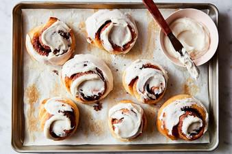

# Perfectly Pillowy Cinnamon Rolls

**Yield:** 8 large rolls  
**Source:** <https://www.kingarthurbaking.com/recipes/perfectly-pillowy-cinnamon-rolls-recipe>

## Ingredients

- Tangzhong*
- 1/2 cup (113 g) whole milk

- 3 tablespoons (24 g) King Arthur Unbleached Bread Flour

* See "tips," below.

- Dough
- 2/3 cup (151 g) whole milk, cold

- 2 1/2 cups (300 g) King Arthur Unbleached Bread Flour

- 1 teaspoon (6 g) salt

- 2 tablespoons (25 g) granulated sugar

- 2 teaspoons instant yeast

- 4 tablespoons (57 g) unsalted butter, softened

- Filling
- 1 tablespoon (14 g) butter, melted

- 1/2 cup (107 g) light brown sugar, packed

- 2 tablespoons (14 g) King Arthur Unbleached Bread Flour

- 3 to 4 teaspoons (8 g to 10 g) cinnamon*

- 1/16 teaspoon (pinch) salt

* Use the lesser amount for stronger cinnamons, like Vietnamese (Saigon); the larger amount for milder cinnamons, like Indonesian/Ceylon.

- Icing
- 3 tablespoons (42 g) butter, melted, divided

- 1/2 teaspoon vanilla extract

- 1/16 teaspoon (pinch) salt

- 1 1/2 cups (170 g) confectioners' sugar, sifted

- 1 to 2 tablespoons (14 g to 28 g) milk, cream, or buttermilk; enough to thin to desired consistency

## Method

1. To make the tangzhong: Combine both the ingredients in a small saucepan, and whisk until no lumps remain.
2. Place the saucepan over medium heat and cook the mixture, stirring regularly, until thickened, paste-like, and the spoon or spatula leaves lines on the bottom of the pan. This should take 1 to 3 minutes, depending on the strength of your burner.
3. Remove from the heat and transfer to a large mixing bowl, the bowl of a stand mixer, or the bucket of a bread machine (whatever you plan to knead the dough in).
4. To make the dough: Weigh your flour; or measure it by gently spooning it into a cup, then sweeping off any excess. Add the cold milk, then the flour and remaining ingredients to the mixing bowl in the order listed; the heat from the tangzhong will help to warm the cold milk.
5. Mix — by hand, on low speed of a stand mixer with the dough hook attachment, or in a bread machine set to the dough cycle — to bring the dough together. Next, knead the dough until it’s smooth, elastic, and tacky. This will take up to 15 minutes by hand, 10 to 12 minutes on medium-low speed of a mixer, or the length of the dough cycle in a bread machine.
6. Shape the dough into a ball, place it in a bowl, and cover the bowl with plastic wrap or a reusable cover.
7. Let the dough rise until puffy but not necessarily doubled in bulk, about 60 to 90 minutes (depending on the warmth of your kitchen).
8. To make the filling: While the dough is rising, put the melted butter into a medium bowl and add the remaining ingredients, stirring until the mixture is the texture of damp sand. Set aside.
9. Lightly grease a baking sheet, or line it with parchment paper.
10. To assemble the rolls: Transfer the dough to a lightly greased work surface and press it into a 10” x 12” rectangle that’s about 1/2” thick. For evenly shaped rolls, try to pat the dough into an actual rectangle (with corners), rather than an oval.
11. Sprinkle the filling over the dough, covering all but a 1/2” strip along one long side.
12. Starting with the filling-covered long side, roll the dough into a log.
13. Score the dough lightly into eight equal 1 1/2” to 2” pieces; this will make large, saucer-sized cinnamon rolls — their generous size is part of their charm. Cut the dough at the score marks. Dental floss will give you the cleanest cut: pull off a long piece of floss, loop it underneath the log at the score mark, and pull the ends in opposite directions to cut the dough. Repeat until you've cut all of the rolls. If you don’t have dental floss, a bench knife or sharp knife will work.
14. Place the rolls onto the prepared baking sheet, spacing them so there’s at least 2” between each one and they’re 2” away from the edges of the pan; a 3-2-3 arrangement works well. To prevent them from unraveling while they rise and bake, tuck the ends of the spirals underneath the rolls so that they’re held in place.
15. Cover the rolls with lightly greased plastic wrap or a reusable cover and let them rise for 30 to 60 minutes (depending on the warmth of your kitchen). The rolls should be puffy and the dough shouldn’t bounce back immediately when gently pressed.
16. About 20 minutes before you’re ready to bake, position a rack in the top third of the oven. Preheat the oven to 375°F.
17. Bake the rolls for 14 to 18 minutes, until they’re a light golden brown and a digital thermometer inserted into the center of one roll reads 190°F. Bake for the lesser amount of time for extra-soft rolls, and the longer amount of time for rolls with a bit more color and slightly firmer texture.
18. Remove the rolls from the oven, place the pan on a rack, and brush the hot rolls with 1 1/2 tablespoons (21 g) of the melted butter. Let the rolls cool for 10 to 15 minutes before icing.
19. To make the icing: Combine the remaining 1 1/2 tablespoons (21 g) melted butter with the remaining icing ingredients in a medium bowl, mixing with a spatula until smooth. Milk makes a lovely frosting; using cream in place of milk creates an extra layer of richness, while substituting buttermilk adds subtle tang, a nice counterpoint to the icing's overall sweetness.
20. Ice the rolls and serve immediately. If you’re planning to serve the rolls later, wait to ice them until just before serving. Store icing at room temperature, tightly covered, until you’re ready to use it.
21. Store completely cooled rolls, un-iced and well wrapped, for a couple of days at room temperature; or freeze for up to 1 month.

## Notes

- With origins in Japan's yukone (or yudane), tangzhong is a yeast bread technique popularized across Asia by Taiwanese cookbook author Yvonne Chen. Tangzhong involves cooking some of a bread recipe’s flour in liquid prior to adding it to the remaining dough ingredients. Bringing the temperature of the flour and liquid to 65°C (149°F) pre-gelatinizes the flour’s starches, which makes them more able to retain liquid — thus enhancing the resulting bread's softness and shelf life.
- Do you enjoy your cinnamon rolls with tangy, thick cream cheese frosting instead of vanilla icing? Stir in 4 to 6 tablespoons (57 g to 90 g) softened cream cheese to the icing along with the other ingredients. The softer the cream cheese is, the easier this will be to do. Resist the urge to add more than 2 teaspoons of milk until the icing is fully mixed. If it’s too thick for your liking, add more milk a teaspoon at a time to get it to the consistency you prefer.
- Many of you have asked how to turn this into an overnight cinnamon roll recipe. It's simple: Make and bake the rolls the day before you want to serve them. The rolls stay wonderfully soft for at least 3 days, and we've found the best way to enjoy them for breakfast is to bake them the day before, store them tightly sealed (and un-iced) at room temperature overnight, then the next morning lightly cover the rolls with foil and warm them in a 300°F to 350°F oven for 5 to 10 minutes. Spread with icing and enjoy.
- Attention, those of you following special diets: Check out our Gluten-Free Cinnamon Rolls and Keto-Friendly Cinnamon Rolls.
