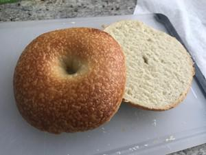

# Bagels

**Source:** <https://www.washingtonpost.com/news/food/wp/2016/05/10/homemade-bagel-recipe-how-to-make-the-best-bagels-at-home/>

## Ingredients

- 830 g bread flour (or all-purpose? these turn out very chewy)
- 2 tsp yeast
- 1 scant Tbsp salt
- 1 Tbsp barley malt syrup
- 450 g water

## Method

1. Mix and knead for 10 m
2. Divide into 8 smooth balls and let rest 5 m.
3. Poke holes and shape into 8 bagels. Place on parchment paper on cookie sheet. Cover with plastic wrap.
4. Let rise 24-48 hrs in the fridge.
5. Boil each side 30-60 s, then bake at 450 F for ~15 m, until golden brown.
