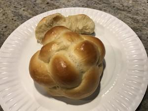

# Challah

**Source:** <http://www.kingarthurflour.com/recipes/no-knead-challah-recipe>

## Ingredients

**Dough:**

- 810-936 g bread flour
- 1 tablespoon + 1/2 teaspoon salt
- 1 1/2 tablespoons instant yeast
- 340 g water
- 4 large eggs
- 170 g honey
- 50 g melted butter
- 50 g vegetable oil

**Glaze:**

- 1 egg (any size) beaten with 1 tablespoon cold water

## Method

1. Mix dough
2. Let rise 2 hours
3. Refrigerate (several hours, up to 4 days)
4. Shape and proof until quite puffy, about 90 minutes
5. Preheat oven to 350 F
6. Brush dough with egg wash
7. Bake for 25-35 m, depending on size, covering with foil if necessary after about 20 m
