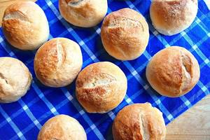

# Crusty European-Style Hard Rolls

**Source:** <http://www.kingarthurflour.com/recipes/crusty-european-style-hard-rolls-recipe>

## Ingredients

**Starter:**

- 1/2 cup cool water
- 1 cup King Arthur Unbleached All-Purpose Flour
- 1/8 teaspoon instant yeast

**Dough:**

- all of the starter
- 3 1/2 cups King Arthur Unbleached All-Purpose Flour
- 1 cup lukewarm water
- 1 1/2 teaspoons salt
- 1/4 teaspoon instant yeast

**Egg Wash:**

- 1 large egg white mixed with 1-2 tablespoon cool water

## Method

1. To make the starter: Mix the starter ingredients together until smooth, cover, and let rest at room temperature overnight.
2. Combine all of the dough ingredients and mix and knead them together — by hand, mixer or bread machine — until you've made a soft, somewhat smooth dough; it should be cohesive, but the surface may still be a bit rough. It may also stick to the bowl just the tiniest bit.
3. Allow the dough to rise, covered, for 3 hours, gently deflating it and turning it over after 1 hour, and again after 2 hours.
4. Turn the dough out onto a lightly greased work surface. Divide it into 12 pieces, shape the pieces into balls, and firm them up by rolling them under your lightly cupped fingers.
5. Place the rolls on a parchment-lined baking sheet, cover them, and let them rise for 1 to 2 hours, until they're puffy, though not doubled in size. They'll flatten out a bit as they rise; that's OK.
6. Cover the rolls, and refrigerate them for 2 to 3 hours. Towards the end of the rolls' chill, preheat the oven to 425°F.
7. Whisk together the egg white and water until frothy. Remove the rolls from the refrigerator, and brush them with the wash; you won't use it all up. Again, don't be discouraged if the rolls seem a bit flat; they'll pick up when the hit the oven's heat.
8. Slash a 1/4" deep cut across the top of each roll. Immediately put the rolls into the oven.
9. Bake the rolls for 20 to 25 minutes, until they're a deep golden brown. Remove them from the oven, and cool on a rack. Or, for best crunch, open the oven door, and allow the rolls to cool in the turned-off, open-door oven.

## Notes

- For larger rolls, divide the dough into 8 pieces, rather than 12. Bake for a minute or two longer.
