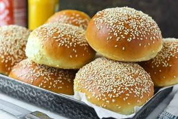

# E's Burger Buns

**Yield:** 4 buns  
**Source:** <http://www.kingarthurflour.com/recipes/beautiful-burger-buns-recipe>

## Ingredients

**Buns:**

- 100 g milk
- 1 Tablespoons neutral oil
- 1/2 large egg
- 20 g potato flour
- 190 g flour
- 12.5 g sugar
- 12.5 g honey
- 5/8 teaspoons salt
- 1/2 Tablespoon yeast

## Method

1. Let rise 1-2 hours, shape, and let proof 1 hour.
2. Brush with egg wash and top with sesame seeds if desired.
3. Bake at 350 F for about 15 minutes.
