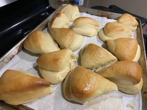

# E's Pillowy Dinner Rolls

## Ingredients

- Tangzhong: 40 g flour 250 g water
- 6 Tbsp Butter, split in half
- 800 g bread flour
- 60 g potato flakes
- 1¾ tsp (13 g) salt
- 20 g sugar (60 g for sweet version)
- 1 Tbsp (11 g) instant yeast
- 110 g water
- 236 g milk
- 20 g honey (60 g for sweet version)
- 1 egg
- extra butter to brush rolls when complete

## Method

1. Mix Tangzhong ingredients and microwave/mix in 30 s intervals until thick as pudding
2. Add half the butter to the Tangzhong to melt & cool
3. Mix dry ingredients, then all other ingredients except butter
4. Knead for 2 m, then incorporate remaining half of the butter (softened) in 1 m intervals
5. Let rise about 1 hr
6. Deflate dough and shape as desired
7. Proof about 45 m
8. Bake at 350 F until golden brown and 200 F inside (about 15-25 m)
9. Brush with melted butter
