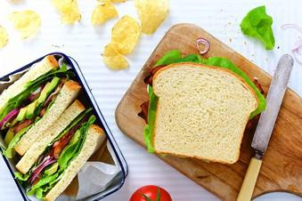

# E's Sandwich Bread

**Yield:** 1 large loaf  
**Source:** <https://www.kingarthurflour.com/recipes/king-arthurs-classic-white-sandwich-bread-recipe>

## Ingredients

- 320 g water
- 48 g honey
- 2 1/4 tsp instant yeast
- 1 3/4 tsp salt
- 2 Tbsp butter
- 450 g bolted flour
- 1/2 tsp diastatic malt powder
- 2 Tbsp whole grain bread improver
- 30 g potato flour
- 35 g dry milk

## Method

1. Rise 1 hr, shape, rise 1 hr, bake at 350 F for 20 m uncovered, 15 m covered
