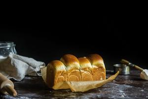

# Hokkaido Milk Bread

**Yield:** Makes one tall 9- x 4-inch loaf  
**Source:** <https://food52.com/recipes/30962-hokkaido-milk-bread>

## Ingredients

**For the tangzhong:**

- 6 tablespoons water
- 2 tablespoons bread flour

**For the rest:**

- 1/4 cup whole milk
- 1 1/2 teaspoons active dry yeast
- 2 3/4 cups (about 350 grams) bread flour
- Scant 1 teaspoons salt
- 1/4 cup sugar
- 1/4 cup heavy whipping cream (or 2 Tbsp butter and 2 Tbsp milk (26 g and 30 g))
- 1 tablespoon sweetened condensed milk or milk powder (optional)
- 2 eggs, 1 for the dough and 1 for the egg wash
- 2 tablespoons butter, softened
- splash milk or water, for the egg wash

## Method

1. In a small saucepan, whisk together 6 tablespoons of water and 2 tablespoons of bread flour until no lumps remain. Heat the mixture over medium-low heat, whisking constantly. It should thicken to a gel-like consistency after just a few minutes. As soon as lines appear in the mixture when stirred, remove it from the heat and transfer it to a small, clean bowl. Let cool to room temperature.
2. Next, heat the milk briefly to just above room temperature, about 110° F or lukewarm to the touch (I do this simply by microwaving it for 10 to 15 seconds). Sprinkle the yeast over the milk and set it aside for 5 to 10 minutes for the yeast to activate (you’ll see the milk start to foam).
3. In the meantime, sift together the bread flour, salt, and sugar in a large bowl. In a smaller bowl or a measuring cup, whisk together the tangzhong, cream, condensed milk (or milk powder), and one egg.
4. When it’s ready, add the yeast mixture to the wet ingredients, and whisk gently, just to incorporate. Make a well in the dry ingredients and pour in all of the wet ingredients. Stir with a wooden spoon until the mixture forms a loose, shaggy dough, then switch to using your hands. Knead for 4 to 5 minutes, or until the dough forms a semi-smooth ball. The dough will be quite sticky -- sprinkle flour over your hands and the dough as is necessary while you knead, but try to avoid over-flouring. (One tablespoon of flour should be enough.)
5. Add the butter to the dough, one tablespoon at a time, kneading after each addition. Add the second tablespoon of butter only after the first has been evenly incorporated. The dough will be slippery and messy at this point, but just keep kneading (actually, it’s oddly satisfying) and it should eventually form a soft and pliable dough that’s easy to work with. Knead for an additional 4 to 5 minutes, or until the dough becomes smooth and elastic.
6. Place the dough in a large bowl with plenty of room and cover the bowl with plastic wrap or a damp towel. Let rise for 1 to 2 hours, or until well doubled. Alternatively, you can let the dough proof overnight in the refrigerator, which I prefer. It gives extra time for the gluten to develop, and yields a better flavor, in my opinion. Plus, dividing the labor over two days makes the process much more manageable. The dough should be fine for up to 24 hours. If storing in the refrigerator, cover more tightly with plastic wrap to avoid drying out, but do not seal completely (an airtight seal can sometimes cause an alcohol-like smell to build up in the dough).
7. Once the dough is doubled, turn it out and punch it down. Divide it into three or four equal pieces. For each piece, roll the dough out to a long oval. Fold the oval into thirds widthwise, then flatten again. Roll the dough up lengthwise, then place into the loaf pan. Repeat with remaining pieces.
8. Let the dough rise again until it's nearly doubled, another hour or so. After about 40 minutes, preheat the oven to 350° F. When the dough seems ready, test it by pressing it gently with one finger; when the indentation bounces back slowly but remains visible, the dough is ready to bake.
9. Whisk your second egg with a splash of milk or water, and brush the egg wash over the dough. Bake for about 30 minutes, or until golden-brown on top. (If your heating element is at the top of your oven and the bread begins to brown too quickly, cover with foil to prevent burning.) When it’s done, the bread will sound hollow when tapped. Let it cool briefly, then slice and enjoy!
