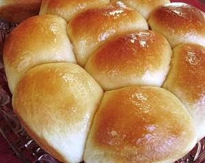

# Like Logan's Roadhouse Dinner Rolls

**Yield:** Serves: 18  
**Source:** <http://tastykitchen.com/recipes/breads/like-logane28099s-roadhouse-dinner-rolls/>

## Ingredients

- 118 g water Warm Water (105-115 F)
- 2-¼ teaspoons Active Dry Yeast
- 1 teaspoon Granulated Sugar
- 118 g Warm Milk (105-115 F)
- 70 g Granulated Sugar
- ⅓ cups Butter Or Margarine, Softened
- 1 teaspoon Salt
- 1 whole Large Egg
- 520 g Bread Flour
- 2 Tablespoons Butter
- 2 Tablespoons Honey

## Method

1. To make the sponge… Put the warm water into a small bowl. Stir the yeast and 1 teaspoon sugar into the warm water until the yeast and sugar are dissolved. Set the mixture aside until it gets foamy, about 15 minutes.
2. To make the dough, combine the milk, sugar, 1/3 cup butter and salt in a large bowl, mixing well. Add the egg and the yeast mixture and mix well. Stir in just enough of the flour to make a soft dough.
3. Turn the dough onto a floured surface and knead in enough of the remaining flour until the dough is smooth and elastic, 8-10 minutes.
4. Butter the inside of a large bowl. Add the dough, turning it to coat the surface with the butter. Cover the bowl with plastic wrap or a clean linen or cloth towel and let the dough rise in a warm, draft-free place until it is doubled in bulk, about 1 hour.
5. Punch down the dough. Shape dough into rolls. The amount of rolls you get out of one batch depends on how big or small you make them. I prefer pan rolls, so I weigh the dough, divide it into 18 equal pieces and place the formed rolls into two 8″ round cake pans with 9 rolls in each pan. Each piece of dough used weighs about 1.9 ounces. I shape them into round balls, but you can shape this lovely dough into any roll shape you choose. Rolls can also be baked in 1 greased 13×9-inch pan or on greased baking sheets—it’s totally up to you.
6. Place the rolls in or on the greased pan(s), cover the pan lightly with plastic wrap that has been sprayed with nonstick cooking spray or a clean linen or cotton towel. Let them rise in a warm, draft-free place until doubled in size, about 20-30 minutes.
7. Preheat the oven to 400 F.
8. For the glaze, melt 2 tablespoons of butter in a small saucepan. Stir in the honey until well mixed.
9. Brush the honey-butter mixture generously over the tops of the rolls. If there is any honey-butter mixture left over, you can use it to brush the tops of the rolls again when they come out of the oven.
10. Bake at 400 F for 10-15 minutes, or until the rolls are golden brown. Remove from the oven and brush with any remaining honey butter if desired. Immediately remove rolls from the pans. Serve warm. Makes 18.
