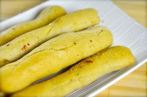

# Olive Garden Bread Sticks

**Yield:** Author: Stephanie Manley via CopyKat.com Recipe Type: Breads Prep time: 2 hours Cook time: 15 minutes Serves: 8  
**Source:** <http://www.copykat.com/2013/12/29/olive-garden-bread-sticks/>

## Ingredients

- 1 1/2 cups warm water
- 1 tablespoon sugar
- 1 tablespoon yeast or one package instant yeast
- 2 tablespoons vegetable oil
- 1 1/2 teaspoons salt
- 4 1/2 cups flour + extra flour for dusting board
- Buttery topping
- 4 tablespoons butter melted
- 1 teaspoon garlic powder
- 2 tablespoons Parmesan cheese
- 1/8 teaspoon oregano

## Method

1. Combine warm water, sugar, oil, and yeast in a large bowl of a mixer or a food processor. Add 4 1/2 cups of flour and salt and process until the dough forms a nice uniform ball. Place dough in a bowl that has been sprayed with non stick spray. Cover bowl with a towel and allow to raise in a warm place. When the dough has doubled in size (this should take about an hour) place dough on a well floured board and roll out dough. Roll out dough into a large rectangle. Cut in half horizontally, and then cut vertical strips of dough about 1 1/2 inches thick. Roll the strips of dough into sticks. Place dough on a greased baking sheet, and allow them to rise until they have doubled in size (this should take about 45 minutes).
2. You should get between 20 and 24 bread sticks from this recipe.
3. Melt butter, and stir in Parmesan cheese and oregano. For best results rub the oregano between your fingers as you place it into the butter. This will help release the oils of the oregano and make it taste even better. Preheat oven to 350 degrees Just before baking bread sticks brush them with butter. Bake for 12 to 15 minutes or until golden brown. Brush any left over butter topping on these just before serving.
