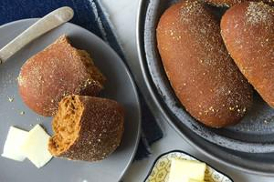

# Outback Bread

**Source:** <http://www.kingarthurflour.com/recipes/dark-and-soft-chain-restaurant-dinner-rolls-recipe>

## Ingredients

**Dough:**

- 1 1/3 cups warm water
- 4 tablespoons butter, softened
- 1/2 cup honey
- 2 3/4 cups King Arthur Unbleached Bread Flour
- 1 3/4 cups King Arthur White Whole Wheat Flour
- 2 teaspoons salt
- 1 tablespoon powdered caramel color; optional, but without it the rolls will lack their distinctive color
- 2 1/2 teaspoons instant yeast

**Topping:**

- yellow cornmeal

## Method

1. Combine all of the dough ingredients in the bucket of a bread machine, or in an electric mixer. If you're using a bread machine, program it for the dough or manual cycle. If you're using a mixer, start with the flat beater, then switch to the dough hook when the dough starts to form a ball and come away from the sides of the bowl.
2. Mix and knead until you've formed a smooth, slightly sticky dough. Note: You may also prepare this dough by hand. It's very sticky and a bit messy at first, but just keep at it, flouring your hands and trying not to add too much additional flour to the dough; eventually it'll smooth out.
3. Let the dough rise in the bowl (or bucket of the bread machine) for 1 hour. It won't have doubled in size, but should be just a bit puffy.
4. Divide the dough into 10 even pieces (about 4 ounces each), and shape the pieces into 6" x 2" oval rolls.
5. Coat each roll, top and bottom, with some yellow cornmeal. Place them on a lightly greased baking sheet, and allow them to rise, covered, in a warm place, for 90 minutes to 2 hours. They won't have doubled in size, but will appear puffy; when you gently press your finger into one, the indentation will rebound quite slowly. Towards the end of the rising time, preheat the oven to 350°F.
6. Bake the rolls for 24 minutes, until the bottoms appear slightly browned (you'll have to carefully pick one up to look), or until a digital thermometer inserted into the center of a roll reads about 200°F.
7. Remove the rolls from the oven, and cool them on a rack.
8. Serve the rolls warm, or at room temperature. Store at room temperature, well wrapped, for several days; freeze for longer storage.
