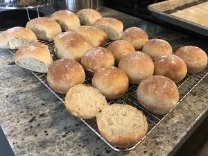

# Rustic Dinner Rolls (Bertucci's Rolls)

131 Calories per roll

**Yield:** 16  
**Source:** <https://msenplace.wordpress.com/2011/02/27/3548501049/>

## Ingredients

- 12.5 oz water
- 1 1/2 teaspoons instant yeast
- 16.5 oz bread flour
- 1 oz whole wheat flour
- 80 g honey
- 1 1/2 teaspoons salt

## Method

1. Whisk water, yeast, and honey in bowl of stand mixer until combined, making sure no honey sticks to bottom of bowl. Add flours and mix on low speed with dough hook until cohesive dough is formed, about 3 minutes. Cover bowl with plastic wrap and let sit at room temperature 30 minutes.
2. Remove plastic wrap and evenly sprinkle salt over dough. Knead on low speed 5 minutes. (If dough creeps up attachment, stop mixer and scrape down using well-floured hands or greased spatula.) Increase speed to medium and continue to knead until dough is smooth and slightly tacky, about 1 minute. If dough is very sticky, add 1 to 2 tablespoons flour and continue mixing 1 minute. Lightly spray 2-quart bowl with nonstick cooking spray; transfer dough to bowl and cover with plastic wrap. Let dough rise in warm, draft-free place until doubled in size, about 1 hour.
3. Fold dough over itself; rotate bowl quarter turn and fold again. Rotate bowl again and fold once more. Cover with plastic wrap and let rise 30 minutes. Repeat folding, replace plastic wrap, and let dough rise until doubled in volume, about 30 minutes. Spray two 9-inch round cake pans with nonstick cooking spray and set aside.
4. Transfer dough to floured work surface; sprinkle top with more flour. Using bench scraper [or a long, not-too-sharp knife], cut dough in half and gently stretch each half into 16-inch cylinders. Divide each cylinder into quarters, then each quarter into 2 pieces (you should have 16 pieces total), and dust top of each piece with more flour. With floured hands, gently pick up each piece and roll in palms to coat with flour, shaking off excess, and place in prepared cake pan. Arrange 8 dough pieces in each cake pan, placing one piece in middle and others around it, with long side of each piece running from center of pan to edge and making sure cut-side faces up. Loosely cover cake pans with plastic wrap and let rolls rise until doubled in size, about 30 minutes (dough is ready when it springs back slowly when pressed lightly with finger). Thirty [or fifteen, if you don’t like the idea of letting your oven run needlessly for 15 minutes] minutes before baking, adjust rack to middle position and heat oven to 500 degrees.
5. Remove plastic wrap from cake pans, spray rolls lightly with water, and place in oven. Bake 10 minutes until tops of rolls are brown; remove from oven. Reduce oven temperature to 400 degrees; using kitchen towels or oven mitts, invert rolls from both cake pans onto rimmed baking sheet. When rolls are cool enough to handle, turn right-side up, pull apart, and space evenly on baking sheet. Continue to bake until rolls develop deep golden brown crust and sound hollow when tapped on bottom, 10 to 15 minutes. Transfer rolls to wire rack and cool to room temperature, about 1 hour. To re-crisp the crust, place rolls in 450-degree oven 6 to 8 minutes. [The rolls are about a billion times better on the day they’re baked, but if you can’t manage to polish off 16 because you’re weird like that, the re-crisping is a pretty good approximation of fresh-baked.]
