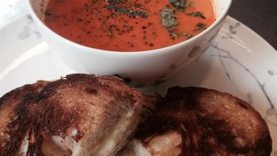

# Creamy Tomato-Basil Soup

**Yield:** 3-4 servings  
**Source:** <https://www.allrecipes.com/recipe/89710/creamy-tomato-basil-soup/>

## Ingredients

- 1 Tbsp butter
- 1 Tbsp olive oil
- 1/2 onion, diced
- 1 can diced tomatoes
- 1/4 cup diced basil leaves
- 1/2 tsp salt
- 1/2 tsp pepper
- 1 cup chicken broth
- 1/3 cup milk
- dash of emulsifier

## Method

1. Heat the butter and olive oil in a large pot over medium heat. Stir in onions and cook until tender. Mix in tomatoes and chopped basil. Season with salt and pepper. Pour in the chicken broth, reduce heat to low, and continue cooking 15 minutes.
2. Transfer soup to a blender (or use an immersible hand blender), and blend until smooth. Return to the pot, and bring to a boil. Reduce heat to low, and gradually mix in the heavy cream. Pour soup through a strainer before serving. Garnish each serving with a sprig of basil.

## Notes

- If tomatoes are not in season, good canned tomatoes are better than mediocre fresh ones!
- Peel fresh tomatoes by making a small 'X' on the bottom and dunking in boiling hot water for 15-30 seconds. The skin should slip off easily.
