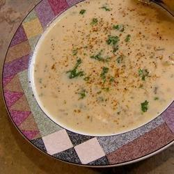

# Easy Cream of Chicken Rice Soup

**Yield:** 1 h 12 servings 137 cals  
**Source:** <https://www.allrecipes.com/recipe/80735/easy-cream-of-chicken-rice-soup/>

## Ingredients

- 2 tablespoons olive oil
- 1 large skinless, boneless chicken breast

- 1 tablespoon butter
- 1/2 onion, chopped
- 2 cloves garlic

- 3 tablespoons all-purpose flour

- 3 cups chicken stock
- 3 cups milk
- carrots, corn, whatever
- 1 tsp salt
- 1/2 tsp pepper
- 1/2 tsp thyme

- 3/4 cup uncooked rice

## Method

1. Heat the olive oil in a large pot over medium heat. Place chicken in the pot, season with salt and pepper, and cook 5 minutes, until juices run clear. Remove chicken, and set aside. Reduce heat to medium-low. Melt butter in the pot. Stir in onion and garlic and cook 5 minutes. Stir in flour, and cook until lightly browned.
2. With a piece of kitchen twine, tie together the parsley sprigs, thyme sprigs, and bay leaf. Pour stock and milk into the pot, and stir in the cooked chicken. Place herb bundle into soup. Simmer 25 minutes.
3. Bring the water to a boil in a separate pot, and stir in instant rice. Cover, reduce heat to low, and simmer 5 minutes.
4. Remove and discard herb bundle from soup. Stir in cooked rice and season with Old Bay before serving.
