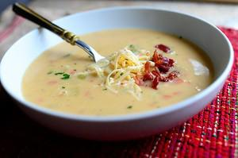

# Perfect Potato Soup

1600 calories for entire batch

**Yield:** 12 Servings  
**Source:** <http://thepioneerwoman.com/cooking/perfect-potato-soup/>

## Ingredients

- 2 slices thick-cut Bacon
- 1/2 Medium Onion, Diced
- 1 cup Carrots, chopped
- 1120 g Russet Potatoes (about 3 large), Peeled And Diced
- 4 cups Low Sodium Chicken Broth
- 1.5 Tablespoons All-purpose Flour
- 3/4 cup Milk
- 1.5 Tbsp Salt
- Black Pepper To Taste
- 1/2 teaspoon Cajun Spice Mix
- 1 oz Grated Cheese Of Your Choice

## Method

1. Add bacon pieces to a soup pot over medium heat and cook bacon until crisp and fat is rendered. Remove the bacon from the pot and set it aside. Pour off most of the grease, but do not clean the pot.
2. Return the hot to medium-high heat and add the onions, carrots, and celery. Stir and cook for 2 minutes or so, then add the diced potatoes. Cook for 5 minutes, seasoning with salt, pepper, and Cajun spice.
3. Pour in the broth and bring it to a gentle boil. Cook for 10 minutes, or until the potatoes are starting to get tender. Whisk together the flour and the milk, then pour into the soup and allow the soup to cook for another 5 minutes.
4. Remove half to 2/3 the soup and blend in batches in a blender/food process until completely smooth. (***USE CAUTION WHEN BLENDING HOT SOUP; IF POSSIBLE, ALLOW THE SOUP TO COOL BEFORE BLENDING***) Pour it back into the soup pot and stir to combine. Let it heat back up as you taste for seasonings, adding more of what it needs. Stir in cream, then stir in parsley, reserving a little for garnish.
5. Serve in bowls garnished with parsley, grated cheese and crisp bacon pieces.
